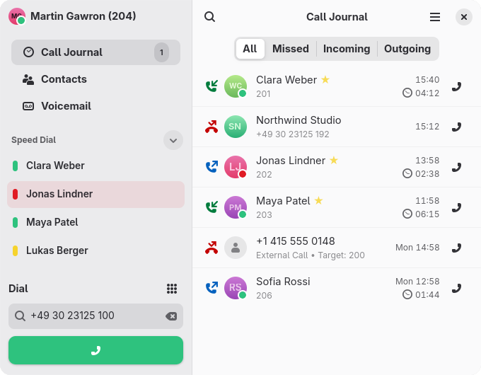

<div align="center">
  
  <h3>Deskphone</h3>
  <p>A modern SIP and PBX softphone for GNOME</p>
  <p>
    <a href="https://deskphone.martingawron.com">Website</a> &middot;
    <a href="https://github.com/megawron/deskphone/issues">Issues</a> &middot;
    <a href="LICENSE">GPL-3.0-or-later</a> &middot;
    <a href="CODE_OF_CONDUCT.md">Code of Conduct</a>
  </p>
</div>

<p align="center">
  <picture>
    <source media="(prefers-color-scheme: dark)" srcset="website/screenshots/deskphone-dark.png" />
    <source media="(prefers-color-scheme: light)" srcset="website/screenshots/deskphone-light.png" />
    
  </picture>
</p>

**Deskphone** is a native Linux softphone built for GNOME. It lets you make and receive calls with standard SIP accounts (such as FRITZ!Box or Sipgate), Asterisk / FreePBX servers, and SwyxWare / Enreach office phone systems - without Wine, browser wrappers, or proprietary clients.

## Features

- **Clean GNOME Design:** Adaptive layout with a call journal (filtered by All, Missed, Incoming, and Outgoing), searchable contacts, voicemail overview, and automatic light & dark styling.
- **Two Lines & Call Transfers:** Handle two simultaneous calls with hold, instant switching, attended merge, and quick drag-and-drop or right-click transfers.
- **Speed Dial & Live Status:** Keep your favorite colleagues in the sidebar with live availability indicators, one-click calling, and group call pickup.
- **GNOME Integration:**
  - Optional read-only sync with **GNOME Contacts** and **GNOME Online Accounts** for caller ID and directory search.
  - Safe `tel:` and `sip:` link handling - clicking a phone number in your browser or address book prefills the dial field without placing an accidental call.
  - Passwords are stored securely in your system keyring, with background operation and desktop notifications for incoming calls.
- **Self-Contained Engine:** Built-in calling, audio, keypad tones (DTMF), voicemail alerts, and instant messaging in Rust.

## Supported Phone Systems

| Provider | What's included |
| --- | --- |
| **Standard SIP** (FRITZ!Box, Sipgate, etc.) | Registration, calls, hold, transfer, keypad tones, GNOME Contacts caller ID |
| **SwyxWare / Enreach** | Calls, live colleague status, speed dials, group call pickup, voicemail, avatars, chat |
| **Asterisk / FreePBX** | Registration, calls, hold, blind & attended transfer, keypad tones |

Want to add support for another phone system (such as STARFACE, innovaphone, or 3CX)? See the [Provider Development Guide](docs/PROVIDER_DEVELOPMENT.md).

## Building & Running

### Dependencies

- Rust toolchain (`rustc` and `cargo`, edition 2024)
- GTK 4 (`>= 4.10`) and Libadwaita (`>= 1.8`) development libraries
- ALSA / PipeWire development headers (`libasound2-dev` or `alsa-lib-devel`)
- Optional: `meson`, `ninja`, `gettext`, and `flatpak-builder`

### Cargo

```bash
git clone https://github.com/megawron/deskphone.git
cd deskphone

# Build and run Deskphone
cargo run --release --bin deskphone

# Launch in demo mode with sample data
cargo run --bin deskphone -- --demo
```

### Meson

```bash
meson setup _build --prefix=/usr/local
meson compile -C _build
meson test -C _build
meson install -C _build
```

### Flatpak

```bash
flatpak-builder --user --install --force-clean _flatpak-build com.martingawron.Deskphone.json
flatpak run com.martingawron.Deskphone
```

## Contributing

Bug reports, pull requests, and new translations are always welcome on [GitHub Issues](https://github.com/megawron/deskphone/issues).

- **Translations:** Deskphone is written in English and includes a German (`de`) translation. To add a language, copy [po/deskphone.pot](po/deskphone.pot) to `po/<lang>.po`, add `<lang>` to [po/LINGUAS](po/LINGUAS), and open a pull request.
- **Architecture & Embedding:** See [docs/PROVIDER_DEVELOPMENT.md](docs/PROVIDER_DEVELOPMENT.md) for adding PBX providers and [docs/FRONTEND_INTEGRATION.md](docs/FRONTEND_INTEGRATION.md) for using `deskphone-core` in other apps or scripts.
- **Local Testbed:** A Docker setup for offline Asterisk and Swyx mock testing is included under `docker/docker-compose.yml`.

This project follows the [GNOME Code of Conduct](CODE_OF_CONDUCT.md).

## License

Deskphone is free software licensed under the **GNU General Public License v3.0 or later** (`GPL-3.0-or-later`). See [LICENSE](LICENSE) for details.
